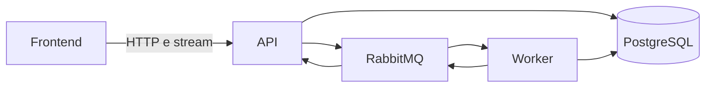
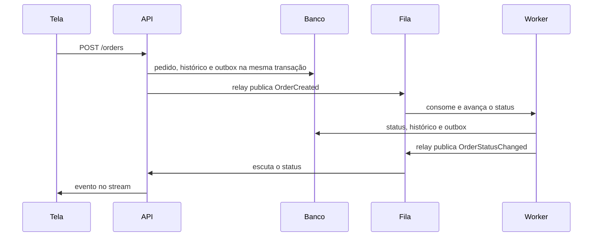

# Gestão de pedidos

Sistema de gestão de pedidos com API .NET, worker, PostgreSQL, RabbitMQ e interface React.

Para configurar e iniciar, só é preciso o Docker. .NET e Node rodam dentro dos containers.

## 1. Pré-requisitos

- [Docker Desktop](https://www.docker.com/products/docker-desktop/) instalado e em execução
- Git
- Portas livres: `5173`, `8080`, `8081`, `5050`, `5432`, `5672` e `15672`

## 2. Clonar o repositório

```bash
git clone git@github.com:SergeyKrimon3/order-management.git
cd order-management
```

## 3. Configurar as variáveis

Copie o exemplo e, se quiser, troque usuário, senha ou portas. Esses valores ficam fora do código.

```bash
cp .env.example .env
```

No Windows PowerShell:

```powershell
copy .env.example .env
```

Se pular este passo, o `docker compose` usa os mesmos padrões do `.env.example`:

| Variável | Padrão | Uso |
| --- | --- | --- |
| `POSTGRES_USER` | `postgres` | Usuário do PostgreSQL |
| `POSTGRES_PASSWORD` | `postgres` | Senha do PostgreSQL |
| `POSTGRES_DB` | `tmb-local` | Nome do banco |
| `POSTGRES_PORT` | `5432` | Porta do banco na sua máquina |
| `PGADMIN_DEFAULT_EMAIL` | `admin@local.dev` | Login do pgAdmin |
| `PGADMIN_DEFAULT_PASSWORD` | `admin` | Senha do pgAdmin |
| `PGADMIN_PORT` | `5050` | Porta do pgAdmin |
| `RABBITMQ_USER` | `admin` | Usuário do RabbitMQ |
| `RABBITMQ_PASSWORD` | `admin` | Senha do RabbitMQ |
| `RABBITMQ_PORT` | `5672` | Porta AMQP na sua máquina |
| `RABBITMQ_MANAGEMENT_PORT` | `15672` | Porta do painel do RabbitMQ |
| `API_PORT` | `8080` | Porta da API |
| `WORKER_PORT` | `8081` | Porta do healthcheck do worker |
| `FRONTEND_PORT` | `5173` | Porta do frontend |
| `LLM_API_KEY` | vazio | Chave do [Ollama Cloud](https://ollama.com/). Sem ela, o chat não responde |
| `LLM_BASE_URL` | `https://ollama.com/v1` | Endereço do Ollama, no formato de chat da OpenAI |
| `LLM_MODEL` | `gpt-oss:20b` | Modelo usado no chat |

`ConnectionStrings__Orders` no `.env` serve para rodar a API direto na máquina, com host `localhost`. Dentro do Docker a API usa o host `postgres`, definido pelo Compose.

## 4. Iniciar o projeto

Na raiz do repositório:

```bash
docker compose up --build -d
```

Esse é o comando de subida. Na primeira vez ele baixa as imagens, compila API, worker e frontend, sobe os serviços e a API aplica as migrations. Espere até os containers ficarem saudáveis.

## 5. Conferir se subiu

```bash
docker compose ps
```

Estes serviços precisam estar `healthy`: `postgres`, `rabbitmq`, `api`, `worker`, `frontend` e `pgadmin`.

| Serviço | Endereço |
| --- | --- |
| Frontend | http://localhost:5173 |
| API | http://localhost:8080/health |
| Worker | http://localhost:8081/health |
| pgAdmin | http://localhost:5050 |
| PostgreSQL | `localhost:5432` |
| RabbitMQ | `localhost:5672` (painel em http://localhost:15672) |

`/health` responde `Healthy` quando o processo, o PostgreSQL e o RabbitMQ estão no ar. API e worker fazem essa checagem.

## 6. Abrir o banco

O banco `tmb-local` fica em `Schemas` → `public` → `Tables`.

| Tabela | O que guarda |
| --- | --- |
| `orders` | Pedido: cliente, produto, valor, status, imagem, pedido de origem e datas |
| `order_status_history` | Cada passagem de status, com a data da mudança |
| `outbox_messages` | Mensagem ainda não publicada, ou já publicada, no RabbitMQ |
| `favorites` | Pedido marcado como favorito |

Em `orders`, `created_at` e `updated_at` são as últimas colunas. Em `outbox_messages`, `created_at` e `published_at` são as últimas.

No pgAdmin, abra http://localhost:5050 e entre com `admin@local.dev` e senha `admin`. Clique com o botão direito em **Servers** → **Register** → **Server**. **Name** fica na aba **General**. O restante fica na aba **Connection**:

| Campo | Valor |
| --- | --- |
| Name | `tmb-local` |
| Host name/address | `postgres` |
| Port | `5432` |
| Maintenance database | `tmb-local` |
| Username | `postgres` |
| Password | `postgres` |

Marque **Save password**. Se aparecer SSL mode, escolha **Disable**.

O host `postgres` só existe na rede do Docker. `localhost` nesse formulário é o próprio pgAdmin, e a porta `5432` recusa a conexão.

No DBeaver, na sua máquina, os campos são os mesmos, com host `localhost`. A porta do banco está publicada no Windows.

## 7. Encerrar

```bash
docker compose down
```

O volume do banco é mantido. Para apagar os dados também: `docker compose down -v`.

## Pedidos

A tela lista, cria, repete e abre o pedido. O status segue uma ordem só: pendente, processando, finalizado.

| Método | Caminho | Uso |
| --- | --- | --- |
| `POST` | `/orders` | Cria o pedido |
| `GET` | `/orders` | Lista, sem o histórico |
| `GET` | `/orders/{id}` | Detalhe, com o histórico em `history` |
| `GET` | `/orders/events` | Stream das mudanças de status |
| `POST` | `/orders/ask` | Pergunta ao modelo sobre os dados |
| `GET` | `/favorites` | Lista os favoritos |
| `POST` | `/favorites` | Marca um pedido |
| `DELETE` | `/favorites/{orderId}` | Remove o favorito |

O frontend chama esses caminhos em `/api/...`.

## Mensageria transacional

Criar um pedido, ou mudar o status dele, grava a linha de negócio e a mensagem na mesma transação do PostgreSQL. A mensagem fica em `outbox_messages`, com `published_at` vazio. O RabbitMQ não entra nessa transação.

Um relay na API e outro no worker leem as mensagens ainda não publicadas com `FOR UPDATE SKIP LOCKED`, publicam na fila e só então preenchem `published_at`. Se o RabbitMQ estiver fora, o pedido continua salvo e a mensagem espera. As duas instâncias do relay não publicam a mesma linha ao mesmo tempo. Se o processo cair depois de publicar e antes de marcar, a mensagem sai de novo: o worker ignora um pedido que já está finalizado.

`OrderCreated` vai para a fila `order-created`. `OrderStatusChanged` vai para `order-status-changed`. As duas filas são duráveis e a mensagem é persistente.

## Histórico de status

Cada pedido guarda a trilha em `order_status_history`: pendente na criação, depois processando e finalizado. A linha entra na mesma transação da mudança, junto com a mensagem do outbox. A página do pedido mostra essa trilha, com a data e a hora de cada passo.

Pedidos que já existiam antes desta tabela recebem o que dá para reconstruir: pendente na data de criação e, se o status atual for outro, esse status na data de atualização. O instante do "processando" desses pedidos antigos não foi guardado.

## Status ao vivo

A lista e a página do pedido escutam `GET /orders/events`. Cada mudança de status chega por esse stream e a tela busca o pedido de novo. A API manda um ping a cada 15 segundos para a conexão não morrer em silêncio.

Se o stream cair, a tela passa a consultar o pedido a cada 3 segundos: a lista chama `GET /orders` e a página do pedido chama `GET /orders/{id}`. Quando a conexão volta, essa consulta para e o stream segue como canal principal.

## Pergunte a IA

O chat ao lado dos favoritos é o marco opcional do projeto. Não há perguntas prontas nem frases gravadas. A pessoa escreve em linguagem livre e o modelo responde com o que está no banco.

O ícone de IA abre o chat. Enter envia. Enquanto o modelo trabalha, o balão mostra **Pensando** com três bolinhas. Quando a resposta chega, o cursor volta para o campo. Fechar o modal encerra a conversa.

O chat usa o [Ollama Cloud](https://ollama.com/), modelo `gpt-oss:20b`. A chamada segue o formato de chat da OpenAI, em `https://ollama.com/v1/chat/completions`. A chave fica só no `.env`, na variável `LLM_API_KEY`, criada em [ollama.com/settings/keys](https://ollama.com/settings/keys). Esse arquivo não entra no Git. Sem a chave, `POST /orders/ask` responde `503`.

| Item | Valor |
| --- | --- |
| Provedor | [Ollama Cloud](https://ollama.com/) |
| Endereço | `https://ollama.com/v1` |
| Modelo | `gpt-oss:20b` |
| Temperatura | `0`, para a resposta seguir os dados |
| Espera máxima | 60 segundos na API |

Quando a URL contém `ollama.com`, a chamada manda `think: false`, então a resposta vem direto, sem o raciocínio interno do modelo.

Outra API compatível com a OpenAI entra no lugar trocando as três variáveis e recriando o container da API. Um Ollama local usa, por exemplo, `LLM_BASE_URL=http://host.docker.internal:11434/v1`.

```bash
docker compose up -d --force-recreate --no-deps api
```

O Compose entrega essas variáveis só para a API, como `Llm__BaseUrl`, `Llm__ApiKey` e `Llm__Model`. O worker não chama o modelo.

### O que o modelo recebe

A cada pergunta a API lê o PostgreSQL e monta o contexto. O modelo não escreve SQL e não enxerga a senha do banco.

- **Pedidos** (`orders`): cliente, produto, valor em reais, status, criação, atualização e, quando houver, o pedido de origem de um "pedir novamente".
- **Favoritos** (`favorites`): o id do pedido favoritado e a data em que foi marcado. O modelo cruza esse id com o pedido.
- **Relógio** de Brasília (`America/Sao_Paulo`), para perguntas como "hoje" ou "neste mês".
- **Histórico** da conversa aberta, até as últimas 20 falas. "Quais são eles?" continua valendo se a frase anterior foi sobre favoritos. Fechar o modal apaga essa memória.

Se a resposta não estiver nesses dados, o modelo diz que não sabe. Ele não inventa pedido, favorito, produto, cliente, valor nem data. A resposta sai no idioma da pergunta, em uma ou duas frases, sem markdown.

O corpo de `POST /orders/ask` leva `question` (de 1 a 1000 caracteres), `locale` e `history`. O nginx espera até 90 segundos por essa resposta.

## Tracing ponta a ponta

Criar um pedido abre um trace no padrão W3C. O `traceparent` fica na linha do outbox e vai no cabeçalho da mensagem do RabbitMQ. O worker continua o mesmo trace ao processar o pedido, e a API continua de novo quando o status volta. API e worker escrevem o `TraceId` no log. O exportador de console do OpenTelemetry imprime cada span.

O health check não entra nesse trace.

## Testes

Na raiz do repositório, com o Docker ligado:

```bash
dotnet test tests/OrderManagement.Tests
```

A suíte tem três grupos:

- **Regras**, sem subir o Compose: status do pedido, favoritos, e o outbox gravado na mesma transação do pedido. O rollback desfaz pedido, histórico e mensagem juntos.
- **Golden tests**, em `tests/OrderManagement.Tests/Golden`. O teste serializa o detalhe do pedido, a listagem, o payload do outbox e o evento de status, e compara o texto com esses arquivos. Uma mudança de campo, nome ou formato quebra a suíte até o arquivo ser atualizado de propósito.
- **Fluxo real**. O teste sobe um PostgreSQL 17 e um RabbitMQ 4 só para aquela execução, com Testcontainers. Aplica as migrations nesse banco, cria um pedido e espera o relay publicar na fila real e o consumidor finalizar o pedido. No fim, os dois containers são apagados. O banco `tmb-local` e a fila do Compose não entram nesse teste. Ele confere a linha em `orders`, as três mensagens em `outbox_messages` com `published_at` preenchido, o histórico pendente, processando e finalizado, e o mesmo `traceparent` nas três mensagens.

## Arquitetura

A tela fala só com a API. A API e o worker compartilham o PostgreSQL. O RabbitMQ leva a criação do pedido até o worker e devolve a mudança de status até a API.



Criar um pedido grava a linha e a mensagem na mesma transação. O relay publica depois. O worker avança o status e a tela recebe o evento.



## Decisões técnicas

| Escolha | Motivo |
| --- | --- |
| .NET 10 | API e worker na linha atual do SDK, publicados nas imagens Docker. |
| EF Core + Npgsql | Migrations versionadas no código e acesso tipado ao PostgreSQL. A API aplica as migrations ao iniciar. |
| RabbitMQ | Filas duráveis para `OrderCreated` e `OrderStatusChanged`, com `CorrelationId` e `EventType`. |
| Outbox | A mensagem nasce na mesma transação do pedido. O relay publica no RabbitMQ depois. |
| Histórico de status | Cada transição fica em `order_status_history`, na mesma transação do status. |
| Status ao vivo | O frontend escuta o stream de eventos. Se ele cair, consulta o pedido a cada 3 segundos até a conexão voltar. |
| Tracing | O mesmo `traceparent` atravessa a API, o outbox, o RabbitMQ e o worker. |
| Golden tests | A resposta da API, o payload do outbox e o evento de status são comparados com JSON aprovado no repositório. |
| Testes de integração | PostgreSQL e RabbitMQ sobem em containers descartáveis. O fluxo do pedido roda neles e os containers somem no fim. |
| React + Vite | A tela é um CRUD, com textos em português, inglês e espanhol. Não há renderização no servidor. |
| Docker Compose | Sobe API, worker, frontend, PostgreSQL, RabbitMQ e pgAdmin com um comando. Segredos ficam em variáveis de ambiente. |
| pgAdmin | Administração do banco dentro do Compose. O DBeaver continua disponível na máquina local. |
| Ollama Cloud `gpt-oss:20b` | O chat chama `https://ollama.com/v1`. O modelo recebe pedidos, favoritos e a conversa aberta, e escreve a resposta. Não há perguntas nem frases prontas. |

## Estrutura

```
src/OrderManagement.Domain            Pedido, favorito, status e contrato das mensagens
src/OrderManagement.Infrastructure    PostgreSQL, outbox, RabbitMQ, tracing e chat
src/OrderManagement.Api               HTTP: pedidos, favoritos, eventos e perguntas
src/OrderManagement.Worker            Consome OrderCreated e avança o status
frontend                              Catálogo, pedidos, favoritos e chat
tests/OrderManagement.Tests           Regras, outbox, contratos golden e fluxo real
```

A API e o worker dependem de Infrastructure, que depende só de Domain. A regra de status (pendente, processando, finalizado) fica testável sem subir o PostgreSQL.
